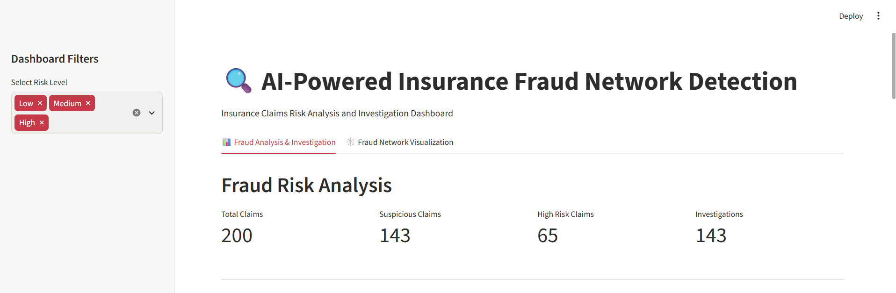
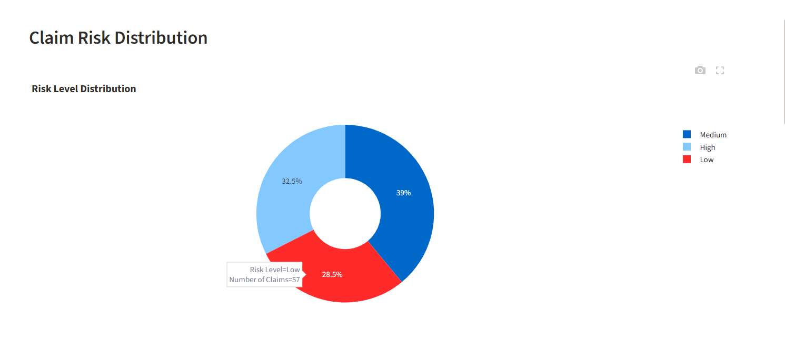
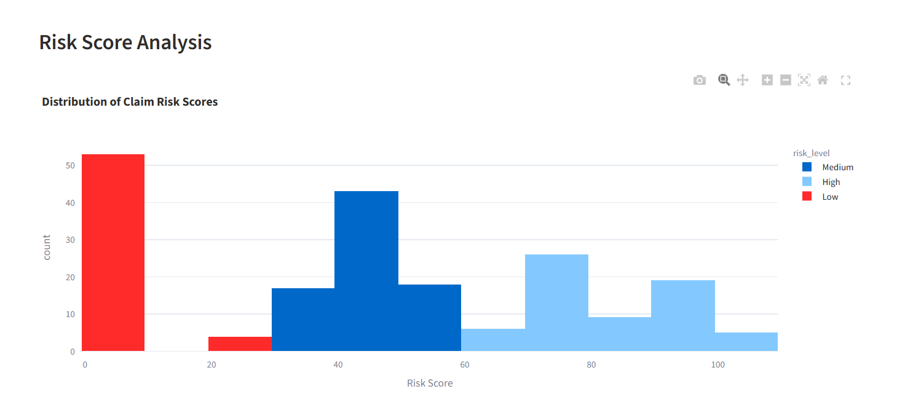
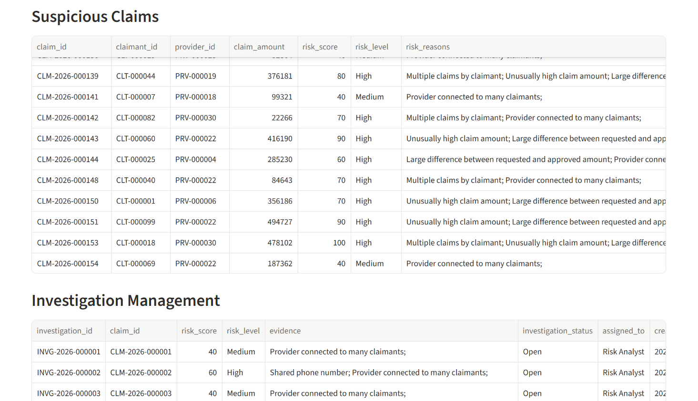
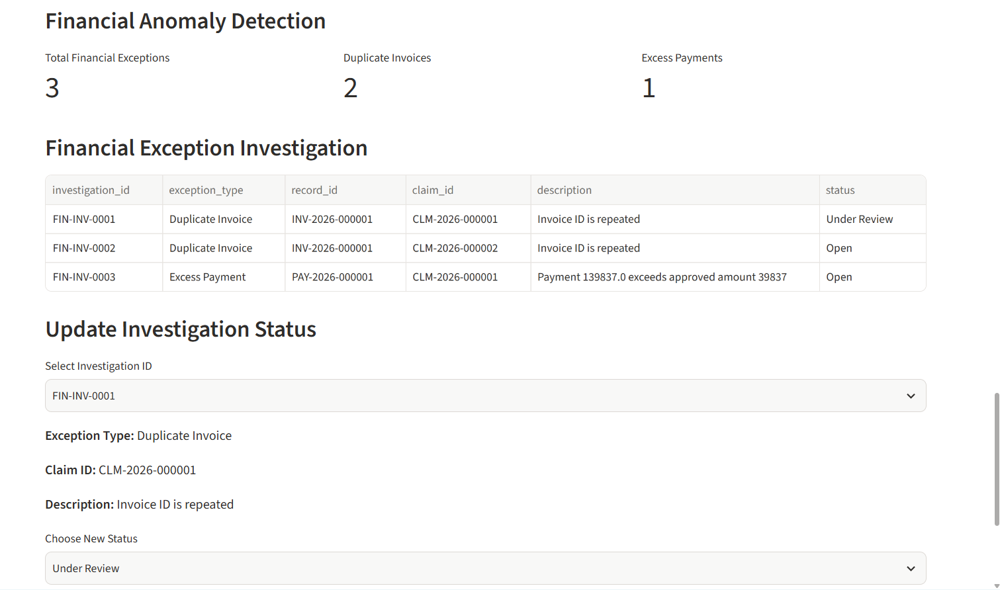
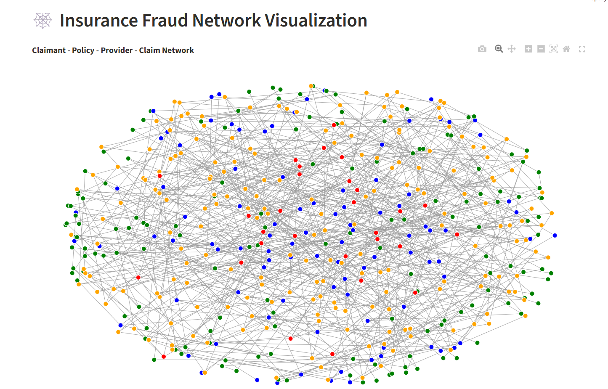
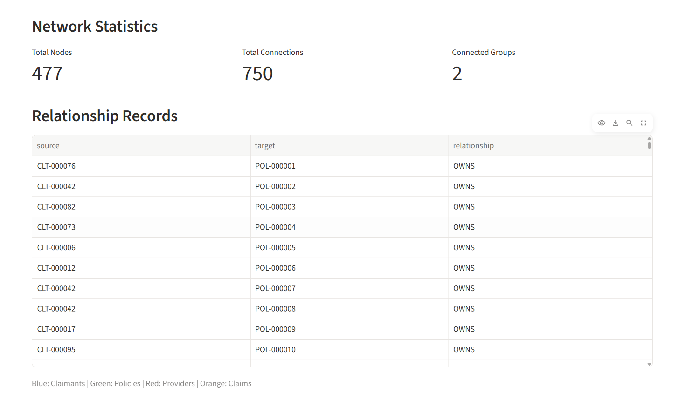

# AI-Powered Insurance Fraud Network Detection and Investigation System

An end-to-end insurance fraud detection and investigation platform that analyzes insurance claims, identifies suspicious patterns, detects financial anomalies, and visualizes relationships between claimants, policies, providers, and claims.

The system uses explainable rule-based risk scoring, relationship network analysis, financial validation, and an interactive Streamlit dashboard to help investigators prioritize suspicious cases.

---

## 1. Problem Statement

Insurance fraud can involve suspicious claim patterns, duplicate invoices, excessive payments, and connections between multiple claimants and service providers.

Traditional claim-by-claim reviews may fail to identify relationships across multiple records.

This project addresses the problem by building a centralized system that:

- Analyzes insurance claims.
- Identifies suspicious claim patterns.
- Assigns risk scores to claims.
- Detects duplicate invoices and excess payments.
- Builds a relationship network.
- Supports investigation tracking.
- Displays results through an interactive dashboard.

---

## 2. Project Objectives

- Generate and manage structured insurance datasets.
- Maintain relationships between claimants, policies, providers, incidents, and claims.
- Validate primary keys and foreign keys.
- Detect suspicious claims using rule-based logic.
- Identify financial transaction anomalies.
- Visualize relationships using NetworkX.
- Manage investigation statuses.
- Evaluate detection results using precision, recall, and F1-score.
- Store processed information in SQLite.

---

## 3. Key Features

### A. Insurance Data Generation
Creates synthetic datasets for:
- Claimants
- Policies
- Providers
- Incidents
- Claims
- Invoices
- Payments

### B. Data Validation
- Primary key uniqueness checks.
- Foreign key validation.
- Missing-value checks.
- Data integrity verification.

### C. Relationship Network Analysis

Uses NetworkX to connect:
- Claimants
- Policies
- Providers
- Claims

Relationships include:
- OWNS
- SUBMITTED
- COVERED_BY
- HANDLED_BY

### D. Rule-Based Fraud Detection

The system assigns risk scores using configurable rules:

| Detection Rule | Risk Score |
|---|---:|
| Claimant has at least 4 claims | +30 |
| Claim amount is at least 350,000 | +30 |
| Claim amount exceeds approved amount by at least 200,000 | +20 |
| Shared claimant phone number | +20 |
| Provider has at least 12 claims | +20 |
| Provider connected to at least 8 distinct claimants | +40 |

The final score is capped at 100.

Risk categories:
- Low: 0–29
- Medium: 30–59
- High: 60–100

These are risk indicators for investigation, not proof of fraud.

### E. Financial Anomaly Detection

Two financial validation rules are implemented:

1. Duplicate invoice ID detection.
2. Payment amount exceeding the approved claim amount.

Detected exceptions receive unique investigation IDs and an initial Open status.

### F. Investigation Management

Investigators can update financial exception statuses through the dashboard:

- Open
- Under Review
- Confirmed Issue
- False Positive
- Closed

Status updates are saved to CSV and SQLite.

### G. Interactive Dashboard

Built using Streamlit and Plotly.

Dashboard features:
- Total claims and suspicious claims.
- High-risk claim metrics.
- Risk distribution charts.
- Risk score analysis.
- Suspicious claims table.
- Investigation records.
- Financial exception metrics.
- Investigation status updates.
- Fraud relationship network visualization.

---

## 4. Technologies Used

| Technology | Purpose |
|---|---|
| Python | Main programming language |
| Pandas | Data processing and analysis |
| NumPy | Synthetic data generation |
| Scikit-learn | Evaluation metrics |
| NetworkX | Relationship network analysis |
| Plotly | Interactive charts and graphs |
| Streamlit | Interactive dashboard |
| SQLite | Database storage |
| Pytest | Automated testing |
| Git and GitHub | Version control |

---

## 5. Project Structure

```text
AI-powered Insurance Fraud Network Detection and Investigation System/
│
├── data/
│   ├── raw/
│   ├── processed/
│   ├── ground_truth/
│   └── insurance_fraud.db
│
├── src/
│   ├── data_generator.py
│   ├── data_validation.py
│   ├── relationship_builder.py
│   ├── fraud_detection.py
│   ├── investigation.py
│   ├── database.py
│   ├── evaluate_model.py
│   ├── inject_fraud_patterns.py
│   ├── financial_data.py
│   ├── inject_financial_anomalies.py
│   └── financial_anomaly_detection.py
│
├── dashboard/
│   ├── app.py
│   └── network_visualization.py
│
├── tests/
│   └── test_system.py
│
├── docs/
│   ├── data_dictionary.md
│   └── schema.md
│
├── requirements.txt
├── README.md
└── .gitignore
```

---

## 6. Installation and Setup

### Step 1: Clone the repository

```bash
git clone YOUR_GITHUB_REPOSITORY_URL
```

### Step 2: Navigate to the project directory

```bash
cd "AI-powered Insurance Fraud Network Detection and Investigation System"
```

### Step 3: Create a virtual environment

```bash
python -m venv .venv
```

### Step 4: Activate the virtual environment

Windows PowerShell:

```powershell
.\.venv\Scripts\Activate.ps1
```

### Step 5: Install dependencies

```bash
pip install -r requirements.txt
```

---

## 7. Running the Project

Run the scripts from the project root in the following order.

### Generate synthetic data

```bash
python src/data_generator.py
```

### Validate data

```bash
python src/data_validation.py
```

### Inject sample fraud patterns

```bash
python src/inject_fraud_patterns.py
```

### Build relationship network

```bash
python src/relationship_builder.py
```

### Detect suspicious claims

```bash
python src/fraud_detection.py
```

### Create investigations

```bash
python src/investigation.py
```

### Generate invoice and payment data

```bash
python src/financial_data.py
```

### Inject financial anomalies

```bash
python src/inject_financial_anomalies.py
```

### Detect financial anomalies

```bash
python src/financial_anomaly_detection.py
```

### Evaluate detection results

```bash
python src/evaluate_model.py
```

### Create SQLite database

```bash
python src/database.py
```

### Launch the main dashboard

```bash
python -m streamlit run dashboard/app.py
```

---

## 8. Current Demonstration Results

The current synthetic demonstration dataset contains:

| Metric | Result |
|---|---:|
| Claimants | 100 |
| Policies | 150 |
| Providers | 30 |
| Claims | 200 |
| Suspicious claims | 143 |
| High-risk claims | 65 |
| Investigations | 143 |
| Financial exceptions | 3 |
| Duplicate invoice records | 2 |
| Excess payment records | 1 |
| Relationship network nodes | 477 |
| Relationship network edges | 750 |
| Connected components in edge-based graph | 2 |

### Automated Testing

Pytest results:

```text
6 passed in 0.97s
```

All six implemented automated tests passed.

### Detection Evaluation

The evaluation script reported:

- Precision: 1.00
- Recall: 1.00
- F1-score: 1.00

**Important:** These metrics are based on only three labelled positive examples. They should not be interpreted as proof of 100% accuracy on unseen insurance claims.

---

## 9. Database

The system uses SQLite to store:

- Claimants
- Policies
- Providers
- Incidents
- Claims
- Relationship edges
- Fraud results
- Investigations
- Invoices
- Payments
- Financial exceptions

Database file:

```text
data/insurance_fraud.db
```

---

## 10. Future Enhancements

- Machine learning-based fraud classification.
- Advanced graph-based fraud detection.
- Interactive investigation assignment.
- Role-based access control.
- Real-time claim monitoring.
- More financial anomaly detection rules.
- Larger labelled datasets for reliable evaluation.
- Explainable AI reports for investigators.

---

## 11. Limitations

- The current datasets are synthetic.
- Fraud detection uses rule-based scoring rather than a trained machine learning classifier.
- Only three positive fraud examples are currently labelled for evaluation.
- Detection results require validation on larger real-world datasets.
- Risk flags indicate suspicious activity and do not establish confirmed fraud.


## Project Screenshots

### 1. Dashboard Overview


### 2. Claim Risk Distribution


### 3. Risk Score Analysis


### 4. Suspicious Claims and Investigations


### 5. Financial Anomaly Detection


### 6. Fraud Network Visualization


### 7. Network Statistics

